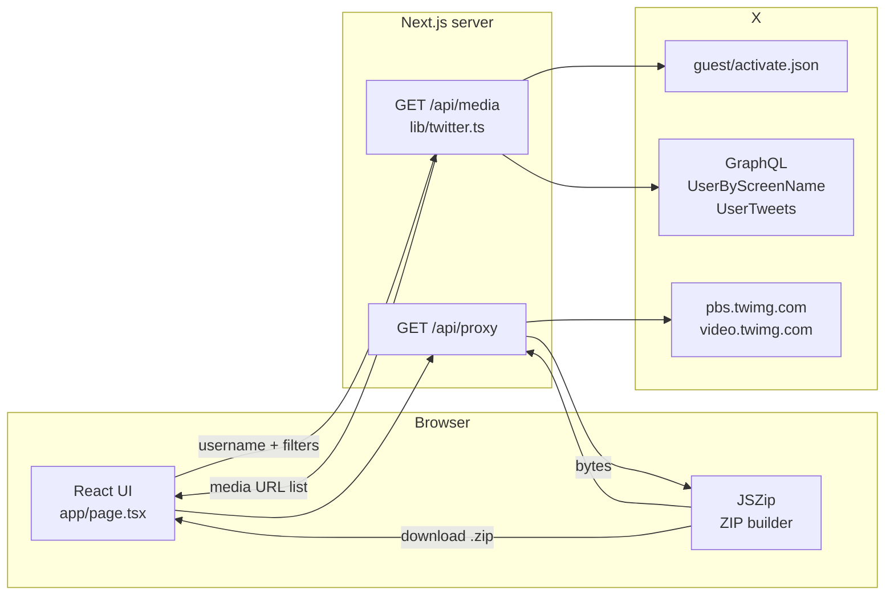

# Architecture

How twitter-save-photos works under the hood.

## Overview

A Next.js app with a server-side X/Twitter scraper and a fully client-side
download/ZIP pipeline. No paid API keys — it reuses the same GraphQL endpoints
that x.com's own web frontend calls.



## Components

### `app/page.tsx` — Frontend (client component)

- Username input + filters (date range, max media)
- Auto-paginating scan loop: calls `/api/media` repeatedly with the
  `nextCursor` until `done`, accumulating items and showing live stats
- Media grid preview (photos streamed through `/api/proxy`)
- Download: fetches each media file through `/api/proxy` (6 parallel
  workers) → adds to `photos/` or `videos/` in a JSZip archive →
  `generateAsync({type: "blob"})` → triggers browser save

### `app/api/media/route.ts` — Scan endpoint

```
GET /api/media?username=X&cursor=…&pages=…&from=YYYY-MM-DD&to=YYYY-MM-DD&maxMedia=N
```

Returns `ScrapeResult` — never fails mid-loop. On any error (incl. 429) it
returns partial results + `nextCursor` so the client can **resume** exactly
where it stopped.

```ts
{
  user: { name, screenName, avatar },
  items: [{ id, type, url, filename, postUrl }],
  pagesFetched, tweetsScanned,
  nextCursor, done, error?
}
```

### `app/api/proxy/route.ts` — Media proxy

- Streams bytes from `pbs.twimg.com` / `video.twimg.com` / `abs.twimg.com`
  (allowlist — can't proxy arbitrary hosts)
- Needed because CDN URLs don't send CORS headers, and it lets the browser
  save files with clean filenames

### `lib/twitter.ts` — The scraper

Core logic. Two X GraphQL operations on `x.com/i/api/graphql/{queryId}/{op}`:

| Step | Operation | Purpose |
|------|-----------|---------|
| 1 | `guest/activate.json` | Anonymous guest token (when no cookies) |
| 2 | `UserByScreenName` | username → `rest_id` (user ID) |
| 3 | `UserTweets` | timeline pages, reverse-chronological, ~40 tweets/page |

**Pagination:** each timeline response embeds a
`TimelineTimelineCursor` entry whose `content.value` is the opaque cursor for
the next page. Returned as `nextCursor`.

**Media extraction:** from each tweet's
`legacy.extended_entities.media[]`:

- `type: "photo"` → `media_url_https + "?name=orig"` (full resolution)
- `type: "video"` / `animated_gif` → `video_info.variants` filtered to
  `video/mp4`, sorted by bitrate → highest quality MP4 wins
- Retweets (`legacy.retweeted_status_result`) are skipped
- `created_at` used for date-range filtering; scan stops early once a page's
  oldest tweet is below the `from` bound (timeline is chronologically sorted)

## Auth modes

```
AUTH_TOKEN + CT0 set in .env.local?
        │
   ┌────┴────┐
  yes       no
   │         │
 Cookie    POST guest/activate.json
 headers    → x-guest-token header
 (higher    (lower rate limits)
  limits)
```

Both modes always send the public web bearer token + browser-like headers.
On 429 the guest token is dropped and retried once with a fresh one.

## Rate limit handling

```
429 → clear cached guest token → wait 3s → retry once
           │
        still fails → return partial items + nextCursor + error
           │
        UI shows error, "Scan" becomes "Resume"
```

Everything is resumable — a scan that fails halfway can continue without
re-downloading the tweet history (items are deduplicated by URL client-side).

## Deployment

Works on Vercel free tier as-is:

- `app/api/media` has `maxDuration = 60` (serverless function budget)
- No env vars strictly required; `AUTH_TOKEN`/`CT0` optionally added in
  Vercel project settings
- `lib/` caches the resolved user + guest token in-memory per warm instance

## Known limitations

- Unofficial endpoints — X can rotate `queryId`s or tighten rate limits.
  The `queryId` constants live at the top of `lib/twitter.ts` for easy updates.
- `UserMedia` (a media-only timeline) exists but is walled for guest tokens;
  we paginate the full timeline instead and filter client/server-side.
- Browsers can't write folders directly — that's why output is a ZIP with
  `photos/`/`videos/` structure.
